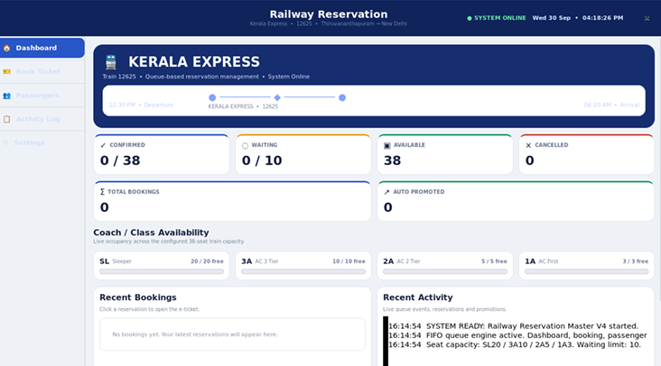
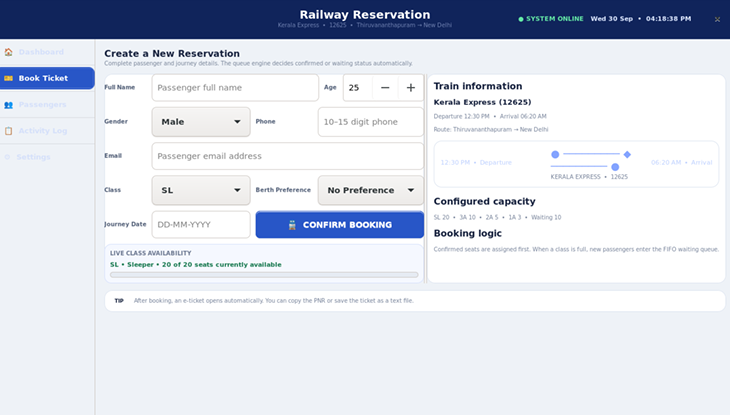
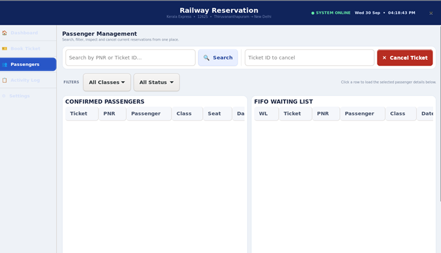
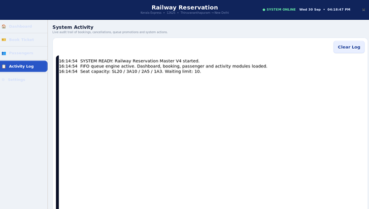

# 🚆 Railway Reservation System (Master V4)

[-blue.svg)](https://en.wikipedia.org/wiki/C_(programming_language))
[](https://www.gtk.org/)
[](https://en.wikipedia.org/wiki/Queue_(abstract_data_type))

An open-ended Data Structures Laboratory project implementing a desktop **Railway Reservation System** in C using a **GTK 3** graphical user interface. The project models the **Kerala Express (Train No. 12625)** running from Thiruvananthapuram to New Delhi.

---

## 📌 Project Overview

Ticket reservation is a classic real-world application of the **FIFO (First-In, First-Out) Queue** data structure:
- **Two Linked-List Queues**: Hand-written singly linked lists with front and rear pointers:
  1. `confirmed`: Holds confirmed passengers (maximum capacity 38 seats).
  2. `waiting`: Holds passengers in a FIFO waiting list (maximum capacity 10).
- **Per-Class Capacity**:
  - **Sleeper (SL)**: 20 seats
  - **AC 3-Tier (3A)**: 10 seats
  - **AC 2-Tier (2A)**: 5 seats
  - **AC First (1A)**: 3 seats
- **Automatic Same-Class FIFO Promotion**: When a confirmed passenger cancels, the earliest waiting passenger for that specific class is unlinked from the waiting queue and promoted to the vacated seat.
- **Seat Reuse Algorithm**: `make_seat()` scans the confirmed queue and reuses the lowest available seat number, preventing duplicates.

---

## 🖼️ Application Screenshots

### 1. Dashboard & Live Statistics
Real-time seat occupancy, class availability progress bars, recent bookings, and activity log.


### 2. New Booking Form
Booking interface with live class availability indicator, validation, and train route overview.


### 3. Passenger Management & Search
Search by Ticket ID / PNR, class/status filtering, passenger details, and cancellation.


### 4. Activity Log & Audit Trail
Real-time audit log tracking bookings, cancellations, same-class promotions, and system resets.


---

## 🏗️ Data Structures & Algorithms

### 1. The Passenger Node (`struct Passenger`)
```c
typedef struct Passenger {
    int ticket_id;                  // Sequential ID starting from 1001
    char pnr[PNR_LEN];              // 10-digit unique PNR starting from 4817263951
    char name[NAME_LEN];            // Passenger name
    int age;                        // Passenger age
    char gender[GENDER_LEN];        // Male, Female, Other
    char phone[PHONE_LEN];          // Contact phone number (10-15 digits)
    char email[EMAIL_LEN];          // Validated email address
    char travel_class[CLASS_LEN];   // SL, 3A, 2A, or 1A
    char from[FROM_LEN];            // Origin: Thiruvananthapuram
    char to[TO_LEN];                // Destination: New Delhi
    char date[DATE_LEN];            // Journey date (DD-MM-YYYY)
    char berth[BERTH_LEN];          // Berth preference
    char seat[SEAT_LEN];            // Allocated seat (e.g., SL-01, 3A-04)
    int waiting_position;           // Current position in waiting queue
    struct Passenger *next;         // Pointer to next node
} Passenger;
```

### 2. The Queue Structure (`Queue`)
```c
typedef struct {
    Passenger *front;               // Pointer to front node (dequeue / scan)
    Passenger *rear;                // Pointer to rear node (O(1) enqueue)
    int size;                       // Active count
} Queue;
```

### 3. Time Complexity Summary

| Operation | Time Complexity | Details |
| :--- | :---: | :--- |
| `enqueue(q, p)` | **O(1)** | Appends to rear via `rear->next` |
| `dequeue(q)` | **O(1)** | Removes from front via `front->next` |
| `remove_ticket(q, id)` | **O(n)** | Unlinks arbitrary node with rear-pointer fix-up |
| `remove_first_class(q, class)` | **O(n)** | Finds earliest waiting passenger of matching class |
| `make_seat(...)` | **O(n + c)** | Gap search ensuring reuse of lowest free seat number |
| `find_ticket(id)` / `find_pnr(pnr)` | **O(n)** | Linear lookup (n ≤ 48 records) |

---

## ⚡ Terminal Commands & Build Instructions

### 1. Prerequisites (Ubuntu / Debian Linux)
Install the required GCC compiler, `pkg-config`, and GTK 3 development headers:
```bash
sudo apt update
sudo apt install -y build-essential pkg-config libgtk-3-dev
```

### 2. Compilation
Compile using GCC with GTK3 flags:
```bash
gcc -Wall -Wextra -Wpedantic src/railway_reservation_v4_responsive_no_top_bar.c -o railway_v4 $(pkg-config --cflags --libs gtk+-3.0)
```
*Or using the included Makefile:*
```bash
make
```

### 3. Running the Application
Launch the executable with a clean environment:
```bash
env -i HOME="$HOME" PATH="/usr/bin:/bin" DISPLAY="$DISPLAY" \
XAUTHORITY="$XAUTHORITY" XDG_RUNTIME_DIR="$XDG_RUNTIME_DIR" \
XDG_DATA_DIRS="/usr/local/share:/usr/share" \
XDG_CONFIG_DIRS="/etc/xdg" ./railway_v4
```
*Or using Make / shell script:*
```bash
make run
# or:
bash scripts/run.sh
```

---

## 📂 Repository File Structure

```
Railway_Reservation/
├── src/
│   └── railway_reservation_v4_responsive_no_top_bar.c   # Complete C program (2,680+ lines)
├── screenshots/
│   ├── 01_dashboard.png                                 # Dashboard & statistics
│   ├── 02_booking_form.png                              # Booking form
│   ├── 03_passenger_management.png                      # Passenger list & search
│   └── 04_activity_log.png                              # Real-time activity log
├── scripts/
│   ├── build.sh                                         # Shell build script
│   └── run.sh                                           # Clean execution script
├── docs/
│   └── Railway_Reservation_System_Report.pdf            # Complete project documentation
├── commands.txt                                         # Standalone terminal commands file
├── Makefile                                             # Linux build & run automation
└── README.md                                            # Project documentation
```

---

## 👥 Project Team & Credits

**Department of Computer Hardware Engineering**  
**Government Polytechnic College Palakkad**  
*Academic Year 2026*

| Sl. No. | Student Name | Roll No. | Contribution |
| :---: | :--- | :---: | :--- |
| 1 | **ANIL VK** | 10 | Queue Engine (Linked list, enqueue, dequeue, unlinking, FIFO promotion) |
| 2 | **AMAN AP** | 8 | Booking Module (Input validation, seat allocation, PNR & Ticket ID) |
| 3 | **MIDHUN M** | 25 | GTK3 Graphical Interface (Pages, widgets, styling, dark mode) |
| 4 | **WILLIAM WILSON** | 36 | Testing, E-ticket generation, search/filtering, documentation |
